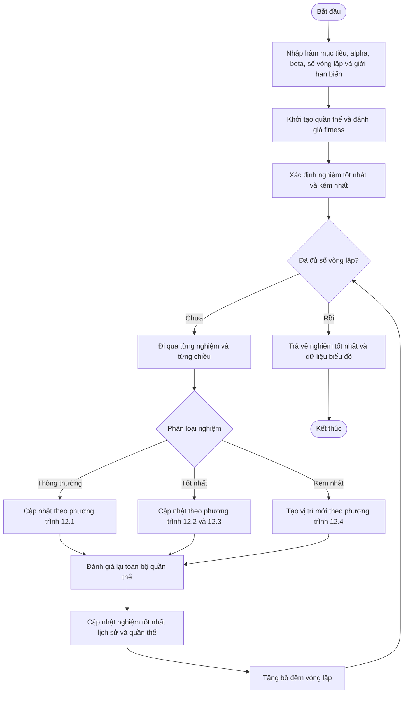

# Block Flow — Sơ đồ khối dự thảo EHO

Sơ đồ dưới đây là **bản phác thảo cho giai đoạn thiết kế**, sẽ phải kiểm tra lại từng nhánh với Algorithm 11 và mã mẫu trong Chương 12 trước khi nộp seminar.

### Ghi chú cho thuyết trình

- Nêu rõ phân biệt **best trong quần thể** và **best từ trước đến nay** khi diễn giải các listing.
- Giải thích công thức nào thuộc nhánh nào, không chỉ mô tả bằng phép ẩn dụ về đàn voi.
- Cần có slide sơ đồ khối và một slide mô phỏng cập nhật tọa độ từ ví dụ §12.5.
